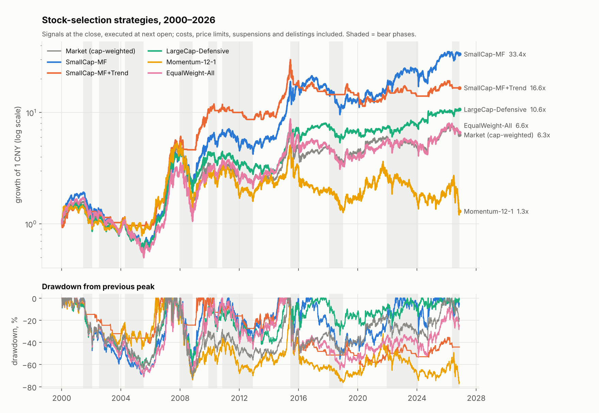
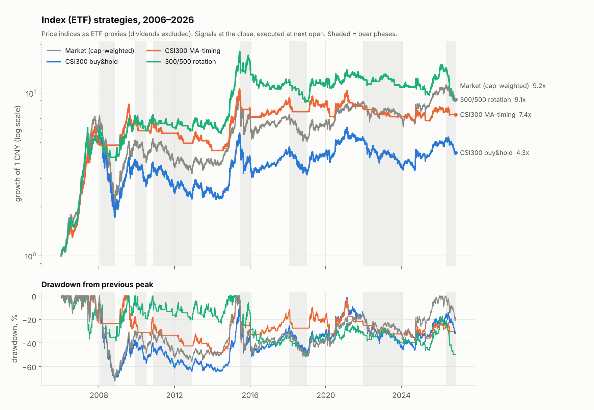
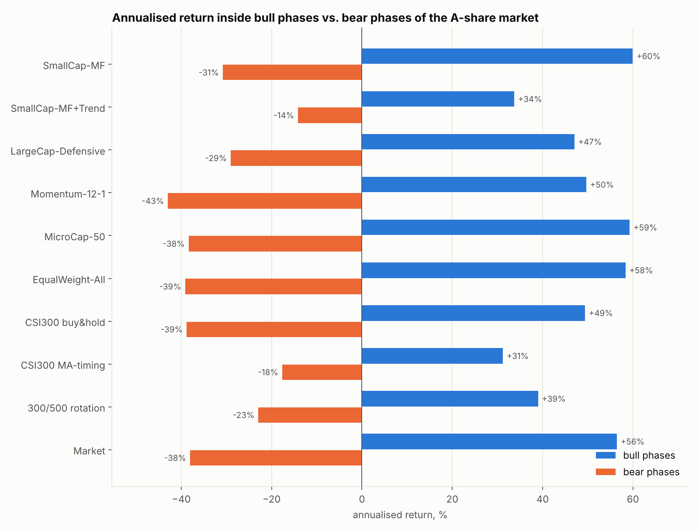

# A-share daily strategies: backtest report

Data to 2026-11-10. Stock strategies are tested from 2000-01-04 (26.8 years), index strategies from
2006-01-04. Full tables are in [`results.md`](results.md) and `tables/*.csv`; everything is regenerated
by `python scripts/run_backtests.py`.

## Summary

- **The best strategy tested is a small-cap multi-factor portfolio (`SmallCap-MF`): 14.0% a year versus
  7.1% for the market, after costs.** It is not a safe strategy: it fell 71% in 2001–2005 and lost money
  over the five years 2017–2021 while the market rose.
- **No long-only strategy made money in bear markets.** The stock selectors lose roughly what the market
  loses; only being out of the market helps.
- **A simple trend filter (go to cash below the 120-day average) halves volatility and bear-market
  losses but does not raise risk-adjusted return.** It helped a lot before 2010 and has cost return since.
- **Classic price momentum does not work in A-shares** (1.0% a year); short-term reversal, low turnover
  and low volatility do.
- **Trading costs decide the outcome.** `SmallCap-MF` pays about 4% of the portfolio a year in costs. If
  real slippage is 0.3% per trade instead of 0.1%, its return drops from 14.0% to 9.9%.

## Strategies

All stock strategies hold 50 names at equal weight and rebalance every 20 trading days.

| Strategy | Rule |
|---|---|
| `SmallCap-MF` | Rank main-board stocks on four signals — small free-float cap, weak last-month return (reversal), low 60-day volatility, low 20-day turnover — and hold the best 50 by average rank. A holding is kept while it stays in the top 100. |
| `SmallCap-MF+Trend` | Same, but everything is sold when an equal-weight index of all stocks closes 2% below its 120-day average, and bought back when it closes 2% above. |
| `LargeCap-Defensive` | Among the 800 largest stocks: low volatility, low turnover, reversal. No size tilt, so far more capacity. |
| `Momentum-12-1` | Among the 800 largest: best 12-month return, skipping the latest month. Included as the textbook factor. |
| `MicroCap-50` | The 50 smallest eligible stocks. The popular "micro-cap" strategy, as a reference. |
| `EqualWeight-All` | Every eligible stock at equal weight. The "average stock". |
| `CSI300 buy&hold` / `MA-timing` / `300/500 rotation` | Index-ETF strategies: hold; hold only above the 120-day average; weekly switch between CSI 300, CSI 500 and cash on 20-day return. |

The benchmark ("Market") is a free-float-cap-weighted total-return index of all A-shares built from the
same data. It tracks the CSI All Share index with 0.99 daily correlation and runs about 2% a year ahead
of it, which is the dividend yield the published price index leaves out.

## Results

**Full period, 2000-01-04 → 2026-11-10**

| Strategy | CAGR | Volatility | Sharpe | Max drawdown | Worst year | Beta | Alpha | Turnover/yr | Costs/yr | Growth of 1 |
|---|---:|---:|---:|---:|---:|---:|---:|---:|---:|---:|
| SmallCap-MF | 14.0% | 25.4% | 0.57 | −70.8% | −43.7% | 0.92 | 7.1% | 9.2x | 4.25% | 33.4x |
| SmallCap-MF+Trend | 11.0% | 17.6% | 0.57 | −61.9% | −17.5% | 0.45 | 6.5% | 6.3x | 2.96% | 16.6x |
| LargeCap-Defensive | 9.2% | 21.5% | 0.43 | −63.0% | −47.8% | 0.79 | 2.9% | 6.1x | 2.93% | 10.6x |
| Momentum-12-1 | 1.0% | 29.4% | 0.11 | −77.5% | −63.9% | 1.02 | −4.8% | 4.3x | 1.99% | 1.3x |
| MicroCap-50 | 8.5% | 29.9% | 0.36 | −84.3% | −54.6% | 1.03 | 2.5% | 4.6x | 2.17% | 8.9x |
| EqualWeight-All | 7.3% | 26.8% | 0.32 | −71.3% | −58.2% | 1.03 | 0.5% | 1.2x | 0.60% | 6.6x |
| Market | 7.1% | 24.7% | 0.32 | −72.3% | −64.7% | 1.00 | – | – | – | 6.3x |

Sharpe uses a 2% risk-free rate. Turnover is one-way, as a multiple of portfolio value.

**Common period including index strategies, 2006-01-04 → 2026-11-10**

| Strategy | CAGR | Volatility | Sharpe | Max drawdown | Worst year | Time invested |
|---|---:|---:|---:|---:|---:|---:|
| SmallCap-MF | 20.4% | 26.0% | 0.77 | −61.9% | −43.7% | 99% |
| SmallCap-MF+Trend | 14.9% | 19.0% | 0.73 | −61.9% | −17.5% | 59% |
| LargeCap-Defensive | 14.1% | 21.7% | 0.63 | −60.5% | −47.8% | 99% |
| CSI300 buy&hold | 7.3% | 24.8% | 0.33 | −72.3% | −65.9% | 100% |
| CSI300 MA-timing | 10.1% | 17.5% | 0.53 | −48.2% | −15.5% | 55% |
| 300/500 rotation | 11.2% | 20.7% | 0.52 | −51.4% | −29.4% | 63% |
| Market | 11.2% | 25.4% | 0.47 | −72.3% | −64.7% | 100% |

The index rows use price indices, so they understate what an ETF holder would have received by roughly
the dividend yield.

## Bull and bear markets

Phases are found mechanically: a bear market starts at a peak once the market index has fallen 20% from
it, a bull market at a trough once it has recovered by the same distance; phases shorter than 60 trading
days are merged. That gives 10 bull and 10 bear phases since 2000.

Total return inside each phase:

| Phase | Market | SmallCap-MF | SmallCap-MF+Trend | LargeCap-Defensive | Momentum-12-1 | CSI300 MA-timing |
|---|---:|---:|---:|---:|---:|---:|
| Bull 2000-01 → 2001-06 | 59% | 92% | 48% | 48% | 42% |  |
| Bear 2001-06 → 2002-01 | −43% | −47% | −13% | −42% | −37% |  |
| Bull 2002-01 → 2002-07 | 33% | 34% | −6% | 35% | 21% |  |
| Bear 2002-07 → 2003-11 | −33% | −42% | −15% | −32% | −22% |  |
| Bull 2003-11 → 2004-04 | 33% | 39% | 13% | 33% | 34% |  |
| Bear 2004-04 → 2005-07 | −48% | −49% | −16% | −44% | −27% |  |
| Bull 2005-07 → 2008-01 | 783% | 779% | 527% | 728% | 540% | 474% |
| Bear 2008-01 → 2008-11 | −72% | −62% | −24% | −60% | −74% | −17% |
| Bull 2008-11 → 2009-11 | 155% | 210% | 130% | 133% | 113% | 47% |
| Bear 2009-11 → 2010-07 | −27% | −16% | −2% | −24% | −29% | −16% |
| Bull 2010-07 → 2010-11 | 40% | 42% | 13% | 33% | 58% | 19% |
| Bear 2010-11 → 2012-12 | −39% | −39% | −26% | −38% | −53% | −30% |
| Bull 2012-12 → 2015-06 | 225% | 349% | 244% | 174% | 217% | 115% |
| Bear 2015-06 → 2016-01 | −50% | −24% | −44% | −29% | −57% | −32% |
| Bull 2016-01 → 2018-01 | 42% | 12% | −13% | 45% | −3% | 32% |
| Bear 2018-01 → 2019-01 | −32% | −33% | 0% | −26% | −40% | −18% |
| Bull 2019-01 → 2021-12 | 77% | 53% | 2% | 26% | 139% | 9% |
| Bear 2021-12 → 2024-02 | −30% | 5% | −5% | −3% | −55% | −14% |
| Bull 2024-02 → 2026-05 | 81% | 97% | 24% | 45% | 83% | 13% |
| Bear 2026-05 → 2026-11 | −19% | −3% | −5% | 4% | −48% | −9% |

Annualised over all bull days and all bear days:

| Strategy | Bull phases | Bear phases |
|---|---:|---:|
| SmallCap-MF | +60.0% | −30.8% |
| SmallCap-MF+Trend | +33.7% | −14.2% |
| LargeCap-Defensive | +47.0% | −29.1% |
| Momentum-12-1 | +49.7% | −43.0% |
| MicroCap-50 | +59.3% | −38.4% |
| CSI300 buy&hold | +49.4% | −38.8% |
| CSI300 MA-timing | +31.2% | −17.7% |
| 300/500 rotation | +39.0% | −22.9% |
| Market | +56.4% | −38.1% |

What the phases show:

- **Stock selection adds return mainly in bull and sideways markets.** In the big crashes (2001–05, 2008,
  2018) `SmallCap-MF` fell about as much as the market.
- **The trend filter works when declines are slow and fails when they are fast.** It cut the 2001–05
  and 2008 losses to a quarter, but lost 44% in the 2015 crash: the market broke the average only after
  a steep fall, and many holdings were locked limit-down or suspended and could not be sold. It then sat
  out or was whipsawed through most of 2016–2021. Its current drawdown, which began in June 2015, has
  not been recovered.
- **Which style wins rotates.** Small caps led 2009–2016 and 2021–2023; large caps led 2016–2017 and
  2019–2020; in 2017 `SmallCap-MF` lost 20% while the CSI 300 gained 22%.

By sub-period (CAGR):

| Period | SmallCap-MF | SmallCap-MF+Trend | LargeCap-Defensive | Market |
|---|---:|---:|---:|---:|
| 2000–2009 | 19.4% | 26.7% | 16.0% | 13.3% |
| 2010–2016 | 19.2% | 7.4% | 7.6% | 3.5% |
| 2017–2021 | −2.1% | −1.9% | 0.2% | 6.4% |
| 2022–2026 | 12.8% | 0.1% | 7.5% | 0.8% |

## Which signals carry the result

Rank correlation between each signal and the next 20 days' return, across main-board stocks, measured
at every monthly rebalance:

| Signal | Mean IC | Annualised IC ratio | 2000–12 | 2013–19 | 2020– |
|---|---:|---:|---:|---:|---:|
| 1-month reversal | 0.077 | 1.63 | 0.084 | 0.070 | 0.070 |
| Low turnover | 0.076 | 1.53 | 0.074 | 0.073 | 0.082 |
| Low volatility | 0.065 | 1.14 | 0.050 | 0.072 | 0.088 |
| Small size | 0.018 | 0.31 | 0.015 | 0.026 | 0.016 |
| 12-1 momentum | −0.002 | −0.03 | 0.004 | 0.004 | −0.019 |

Reversal, low turnover and low volatility are stable across all three eras. Size is a weak and erratic
predictor on its own, yet removing it from the portfolio costs the most return (14.0% → 9.0%): the other
signals pay off far more among small stocks. That also means the strategy's capacity is limited.

## Robustness of `SmallCap-MF`

| Change | CAGR | Sharpe | Max drawdown |
|---|---:|---:|---:|
| Baseline | 14.0% | 0.57 | −70.8% |
| Slippage 0 / 0.3% / 0.5% per trade (baseline 0.1%) | 16.1% / 9.9% / 5.9% | 0.64 / 0.42 / 0.28 | −69% / −75% / −78% |
| Today's stamp duty applied to all history | 15.5% | 0.62 | −66.8% |
| 10 / 20 / 100 / 200 holdings | 15.4% / 14.9% / 14.1% / 14.6% | 0.60 / 0.60 / 0.57 / 0.59 | −65% to −70% |
| Rebalance every 5 / 10 / 40 / 60 days | 12.7% / 13.3% / 12.8% / 12.3% | 0.52 / 0.54 / 0.52 / 0.51 | −69% to −77% |
| No holding buffer | 13.6% | 0.55 | −71.0% |
| Trade one day later / five days later | 13.2% / 11.8% | 0.54 / 0.49 | −72% |
| Add ChiNext and STAR | 14.8% | 0.59 | −70.8% |
| Drop the least liquid 30% (baseline 10%) | 9.7% | 0.42 | −66.1% |
| Only the 1,500 largest stocks | 12.6% | 0.52 | −70.8% |
| Without size / reversal / low-vol / low-turnover | 9.0% / 13.3% / 18.8% / 13.7% | 0.41 / 0.56 / 0.69 / 0.54 | −63% to −74% |
| Trend filter on 60 / 250-day average | 10.9% / 12.2% | 0.59 / 0.61 | −51% / −60% |
| Delisted holdings written off entirely | 13.9% | 0.56 | −70.8% |

- The result does not hinge on the number of holdings, the rebalance interval, or a one-day execution
  delay, which is what a real effect should look like.
- It does hinge on **liquidity and cost**: a third of the edge disappears when the least liquid 30% of
  stocks are excluded, and most of it at 0.5% slippage.
- Dropping low volatility would have returned 18.8%. I did not adopt that: choosing the mix after seeing
  the result is how backtests get overfitted.

## Limitations

- **Hindsight in the design.** The four signals were chosen because they are known to have worked in
  A-shares. The backtest confirms that history; it is not an out-of-sample test. Expect less going forward.
- **ST status is approximated.** No free point-in-time ST list exists, so ST stocks are inferred from
  5% price-limit behaviour, plus a 2 CNY price floor. Some ST stocks will have slipped into the
  small-cap portfolios, and a real account may be barred from or unwilling to buy them.
- **No fundamentals.** Only price, volume and turnover are used. Value, quality and earnings signals,
  which matter more now that failing companies are actually delisted, are not tested.
- **Execution is idealised.** Fills are assumed at the opening price plus 0.1%. Fifty small caps bought
  in the opening auction with a large account would move prices more than that. Positions are fractional;
  with a small account, 100-share lots make equal weighting uneven.
- **Free data.** Prices from Eastmoney and factors from Sina were spot-checked (dividend adjustments,
  delisted stocks, agreement with the CSI All Share index) but not reconciled against a paid vendor.
- **Index strategies** use price indices as ETF stand-ins and assume cash earns nothing.
- **Regime risk.** The small-cap premium before 2017 was partly a "shell value" effect that IPO reform
  removed. The 2017–2021 loss is what the next such shift would look like.

## If you want to trade one of these

1. `SmallCap-MF` has the highest return and `SmallCap-MF+Trend` the mildest ride; their Sharpe ratios
   are the same. Choose on the drawdown you can sit through, not on the CAGR. With either, a loss of half
   the account at some point is the historical norm, not a tail case.
2. For a first strategy with less to go wrong, `CSI300 MA-timing` with one ETF trades about three times
   a year and cut the worst drawdown from 72% to 48%.
3. Paper-trade for a few months with `scripts/generate_signals.py` and compare your real fills with
   the backtest's assumed open + 0.1% before committing capital.
