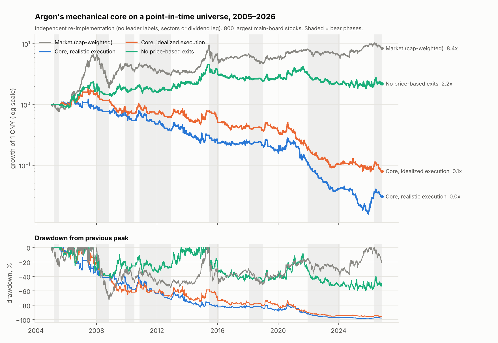

# Audit of the "Argon" strategy

**Verdict.** The reported results are not reliable evidence that the strategy works, and the core
trading logic fails an independent test. Rebuilt from the written rules and run on a point-in-time
universe with realistic execution, Argon's mechanical core **loses money in its own test window
(−23% to −74%) and in every five-year block since 2005 (−14.7% a year)**. The positive numbers in the
document depend on a hand-picked stock list, same-close execution and hand-assigned "leader" labels.

What I had: only the written summary. I did not have Gemini's code, trade log, stock lists or the
HTML report, so I cannot check its arithmetic directly. Everything below is either a check against
market data or my own re-implementation (`quant/argon.py`, `python scripts/audit_argon.py`); full
tables are in [`results.md`](results.md).

Each finding is tagged: **[Validated]** tested on data here; **[Likely]** follows from the document's
own statements plus my tests, but not provable without Gemini's artifacts; **[Hypothesis]** needs
further testing.

## 1. Are the backtest results valid?

### What checks out

| Claim | Check | Status |
|---|---|---|
| 502 trading days, 2024-10-17 → 2026-11-10 | Exactly 502 in exchange data | **[Validated]** |
| CSI 300 +6.89% over the period | +7.15% close-to-close from 10-17, +5.94% from 10-16; the claim sits between | **[Validated]**, roughly |
| 27 wins + 15 losses = 64.3% | Arithmetic is consistent | **[Validated]** |

So the window and benchmark come from real data; the document is not invented wholesale. The
trade-level figures (42 trades, profit factor 11.95, −18.80% drawdown) cannot be verified without the
trade log.

### What does not hold up

**1. The headline is disowned by its own audit. [Validated from the document]**
+785.74% over 502 days is 189% a year. The document's own corrections cut it to +314%, +277%, +165%
and finally +63%: more than nine-tenths of the profit disappears once flaws it already admits are
removed.

**2. The stock universe was chosen with hindsight, and the "corrected" figures still are. [Validated for the mechanism, Likely for Argon]**

| Universe (identical rules, realistic execution, Argon's window) | Total return |
|---|---:|
| 35 random stocks from the 300 largest, 200 draws: median | −4.7% |
| … 95th percentile / best of 200 | +27.1% / +56.9% |
| 89 random stocks from the 800 largest, 200 draws: median | −21.1% |
| … 95th percentile / best of 200 | +11.4% / +39.6% |
| Argon's "execution-adjusted" claims | +165% (35 names), +63% (89 names) |

None of 400 unbiased universes reached even the lower of Argon's two "adjusted" figures. A list of 35
or 89 names is not a universe; it is a selection, and the only way to land that far in the tail is to
select with knowledge of what happened. The spread is enormous: the median main-board stock gained 7%
over the window while the 35th best gained 334%.

**3. Same-close execution inflates results several-fold. [Validated]**
On a deliberately cheating universe (the 35 best performers among the 800 largest, which averaged
+160% buy-and-hold):

| Execution | Total return | Max drawdown | Win rate |
|---|---:|---:|---:|
| Decide at close, trade next open, respect price limits | +24.9% | −38.7% | 43% |
| Decide and trade at the same close, including limit-up closes | +141.7% | −16.7% | 49% |

Perfect foresight on the stock list plus idealized fills gives +142% with a −17% drawdown, which is
close to Argon's "execution-adjusted 35-stock" figures (+165%, −18.8%). **[Likely]** that scenario
still contains both biases. Note also that even with a perfect stock list, the rules captured only
25 points of the 160 available: the exit stack throws most of the move away.

**4. The score is dominated by hand-assigned labels, not data. [Validated from the document]**
A stock beating the CSI 300 by 20% on all three horizons earns 0.20 from momentum. The leader,
quadrant and clarity bonuses add up to **0.85**. The 0.70 threshold for switching into offense is
therefore unreachable on data alone and is in practice decided by who was labelled a "recognised
market leader". A leader list written in 2026 for a 2024–2026 backtest is look-ahead. The document also
admits "historically hard-coded event windows".

**5. The dividend leg uses non-point-in-time valuation. [Likely]**
`DynamicPB = BasePB × price ratio` assumes book value never changes and depends on when the base
snapshot was taken; if it post-dates the start of the test, it is look-ahead. The three named
defensive stocks were also strong performers in the window (Agricultural Bank +62%, Shenhua +35%,
Yangtze Power +12%, against +7% for the CSI 300).

**6. Far too few trades for the number of settings. [Validated from the document]**
I count roughly 50 tunable numbers in the specification against 42 trades in one two-year window. The
95% confidence interval on a 27-of-42 win rate is about 49% to 77%. Twelve ablations on the same
window are twelve more looks at the same data, not out-of-sample tests.

**7. One market regime, the easiest benchmark. [Validated]**
The window starts three weeks after the September 2024 policy rally and contains no 2008, 2015, 2018
or 2022. The CSI 300 (+7%) was the weakest broad index; the CSI 500 gained 23%, the equal-weighted
main board 36%.

**8. Internal inconsistencies. [Validated from the document]**
The 50% + 45% dual-leader template exceeds the 85% maximum exposure. "First holding day" loss cuts
cannot be executed that day under T+1. The live script does not match the research code and carries a
possible 100× scaling bug, so even a valid backtest would not describe what is traded.

## 2. Is the trading logic sound?

I rebuilt everything the document specifies mechanically: regime-capped exposure, the relative-momentum
score, the five-condition breakout gate, two positions, and all nine exit layers. I could not rebuild
the sector quadrants, leader labels, financial-quality score or dividend leg (idle money stays in
cash), and the regime thresholds are my reconstruction because the document does not give them.

### In Argon's own window

| Universe (point-in-time), realistic execution | Total return | Max drawdown | Trades | Win rate | Profit factor |
|---|---:|---:|---:|---:|---:|
| All main-board stocks | −74.2% | −82.5% | 231 | 31% | 0.69 |
| 800 largest | −23.1% | −60.5% | 159 | 30% | 0.92 |
| 300 largest | −26.5% | −38.2% | 103 | 37% | 0.74 |

### Across 2005–2026

| Variant (800 largest unless stated) | Return/yr | Max drawdown | Win rate | 2005–09 | 2010–14 | 2015–19 | 2020–26 |
|---|---:|---:|---:|---:|---:|---:|---:|
| Core, realistic execution | −14.7% | −98.8% | 32% | −7.9% | −14.7% | −11.3% | −22.1% |
| Core, idealized execution | −10.9% | −95.9% | 37% | −5.2% | −4.1% | −10.3% | −20.0% |
| 300 largest | −8.8% | −91.2% | 36% | 0.5% | −12.7% | −7.4% | −13.5% |
| 10 positions instead of 2 | −8.3% | −90.7% | 33% | 2.5% | −10.0% | −9.0% | −14.0% |
| No breakout gate | −27.0% | −99.9% | 30% | 8.5% | −18.4% | −34.4% | −46.0% |
| No regime control | −3.9% | −73.4% | 31% | −10.4% | −5.2% | −0.9% | 0.0% |
| No early cuts (exit layers 1–3 off) | −7.0% | −90.4% | 39% | −3.6% | −5.6% | −8.7% | −9.3% |
| No price-based exits at all | +3.7% | −60.2% | 48% | 11.6% | 12.2% | −1.1% | −3.5% |
| Market | +10.3% | −72.3% | – | | | | |

### Why it fails

**The selection signal points the wrong way. [Validated]**

| Measure, 800 largest stocks, 2005–2026 | Value | t-statistic |
|---|---:|---:|
| Rank correlation of Argon's momentum score with the next 20-day return | −0.048 | −8.1 |
| Stocks passing the entry gate: next 20 days vs. the average stock | −0.5% | −2.8 |
| The top 2 by score among them (what Argon buys) | −0.8% | −1.9 |

The correlation is negative in all four sub-periods. In A-shares, stocks that have recently
outperformed and are breaking to new highs on rising volume tend to underperform over the following
month. This matches the earlier studies in this repository, where one-month reversal and low turnover
were the strongest signals and 12-month momentum earned 1% a year.

**The exit stack multiplies a losing bet. [Validated]**

| Exit layer | Trades | Avg return | Stock vs. market over the next 20 days |
|---|---:|---:|---:|
| Next-day failure cut | 214 | −7.3% | −1.9% |
| Breakeven lock | 362 | −1.2% | −2.0% |
| Early support cut | 185 | −6.5% | +0.4% |
| Hard stop 10% | 57 | −10.7% | −2.7% |
| Trailing stop | 135 | +14.7% | −0.7% |

- The stops are not selling into rebounds; the stocks mostly keep lagging afterwards. The problem is
  the entries. Each entry loses about 0.8% on average, and tight stops turn 229 trades into 1,147.
- Realised losses are much larger than the stop levels suggest (a "3.5%" cut averages −7.3%) because
  the sale happens at the next open, after the gap.
- "Small losses, large winners" did not materialise: the win rate is 32% and the profit factor 0.78.

**Two positions make the outcome a lottery. [Validated]**
Results swing by tens of points between near-identical universes (see the random draws above). No
conclusion about skill can be drawn from 42 trades in two names at a time.

**Regime control: partly informative, partly backwards. [Hypothesis, because the thresholds are my reconstruction]**
The market returned 1.7% over the 20 days after a "mainline bull" label against 0.3% after "chop",
which is the right order. But "overheated, trim to 40%" was followed by the strongest returns (+4.8%),
and "full defense" (+0.8%) was no worse than "chop".

**What I could not test.** Sector strength and crowding, the leader bonus, the quality score and the
dividend leg. These may add value, but as specified they rest on labels and snapshots that are not
point-in-time, so they are unvalidated rather than validated.

## 3. Weaknesses and concrete improvements

| # | Change | Evidence | Status |
|---|---|---|---|
| 1 | **Replace the momentum-breakout selector** with signals that test positive: low turnover, short-term reversal, low volatility, or the walk-forward model in `reports/ml` | Argon score IC −0.048; the model's out-of-sample IC is +0.142, positive in all 22 years | **[Validated]** |
| 2 | **Hold 30–50 stocks, not 2** | Two-position outcomes range from −28% to +57% across random universes; 20–200 holdings changed the ML result by under 6 points | **[Validated]** |
| 3 | **Drop the tight price stops and breakeven lock; rebalance on a schedule** | Removing price exits lifted the core from −14.7% to +3.7% a year by cutting trades five-fold | **[Validated]** |
| 4 | **Replace the four-state regime and "overheated trim" with a volatility target** | Cut drawdown from −63% to −34% in the ML study and from −52% to −31% in the basket study | **[Validated]** in those studies |
| 5 | **Model execution honestly**: next-open fills, no limit-up buys, no limit-down sells, T+1, 100-share lots, stamp duty | Same-close fills turned +25% into +142% on the same trades | **[Validated]** |
| 6 | **Use a point-in-time universe** with delisted stocks; delete the leader list and hard-coded event windows | 0 of 400 unbiased universes reached Argon's adjusted figures | **[Validated]** |
| 7 | **Test from 2005 with walk-forward refits**, and report results by bull and bear phase | Argon's window is one regime | **[Validated]** as a requirement |
| 8 | **One codebase for research and live trading**; fix the scaling bug before any order is sent | Stated in the document | **[Validated from the document]** |
| 9 | Sector relative strength, using dated industry classifications | Not testable with my data | **[Hypothesis]** |
| 10 | Dividend/defensive leg, using dated fundamentals instead of a base snapshot | Not testable with my data | **[Hypothesis]** |
| 11 | ETF sleeve for ChiNext/STAR exposure | Trend rules on ETFs were weak in the basket study | **[Hypothesis]** |

Changes 1–7 together are, in effect, the walk-forward strategy already in this repository. Over Argon's
own window, all out-of-sample:

| Strategy, 2024-10-17 → 2026-11-10 | Total return | Max drawdown | Sharpe |
|---|---:|---:|---:|
| Argon core (my replication, 800 largest) | −23.2% | −60.6% | −0.34 |
| Walk-forward ML model, 50 stocks | +58.6% | −29.8% | 1.10 |
| ML model + volatility target | +32.7% | −28.6% | 0.75 |
| Rule-based SmallCap-MF | +39.7% | −20.3% | 0.88 |
| Equal weight, main board | +28.9% | −23.5% | 0.62 |
| Market (cap-weighted) | +18.4% | −21.2% | 0.45 |

These are far below Argon's claims and far more defensible, and they come with 22 years of
out-of-sample history rather than two. They still carry the caveats in the ML report, chiefly trading
costs and a shrinking edge.

## What would settle the open questions

To move the **[Likely]** items to validated, ask Gemini for:

1. The backtest code and the 42-trade log (dates, prices, sizes).
2. The 35- and 89-stock lists and the date each list was written.
3. The "recognised leader" assignments, the sector map, and the hard-coded event windows, with dates.
4. The base date of the PB and dividend-yield snapshots.
5. The diff between the research scoring and the live script.

If the lists or labels were created after October 2024, the results are in-sample by construction.

## Limits of this audit

- My replication omits the discretionary components, so it tests Argon's mechanical core, not the
  full system. It shows the core has no edge; it cannot show what the labels would have added had
  they been assigned in real time.
- Regime thresholds, the trailing-stop schedule and position sizing are reconstructed where the
  document is vague. The conclusion does not hinge on them: the core loses with or without the regime
  layer, with 2 or 10 positions, and with or without each exit group.
- Free data sources, and the same ST approximation as the earlier reports.
