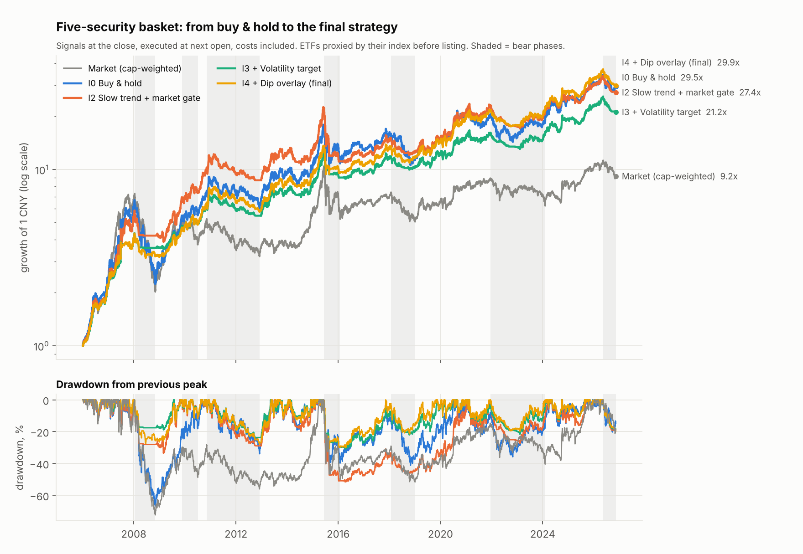
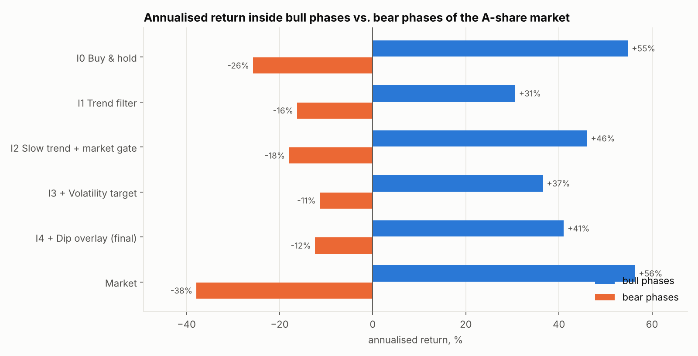

# Five-security basket: iterative strategy development

Securities: **510300** (CSI 300 ETF), **159915** (ChiNext ETF), **600066** (宇通客车 Yutong Bus),
**600406** (国电南瑞 NARI Technology), **000895** (双汇发展 Shuanghui).

> You wrote "60066", which has five digits. I read it as **600066**. If you meant 600660 (福耀玻璃
> Fuyao Glass), the conclusions are the same and the numbers are in the last section.

Backtest 2006-01-04 → 2026-11-10, signals at the close, trades at the next open, costs included
(0.03% commission + 0.10% slippage per side, stamp duty on the stocks). Full tables:
[`results.md`](results.md). Regenerate with `python scripts/optimize_basket.py`.

## Result

| | Buy & hold (start) | Final strategy |
|---|---:|---:|
| Return per year | 17.6% | **17.7%** |
| Maximum drawdown | −66.6% | **−31.2%** |
| Sharpe ratio | 0.67 | **0.90** |
| Winning months | 60% | **63%** |
| Winning round-trip trades | – | 56%, winners 4.6× the losers in total |
| Worst calendar year | −54.5% (2008) | −21.6% (2008) |
| Bear phases, annualised | −25.7% | −12.4% |
| Bull phases, annualised | +54.8% | +41.0% |

The optimisation halved the drawdown and the bear-market loss while keeping the full buy-and-hold
return. It did not raise the return: these five securities already returned far more than the market
(9.2× for the market against 29.5× for the basket), and no timing rule I tested extracted more than
simply holding them.



## The iterations

Each step was kept only if it improved risk-adjusted return in the 2006–2016 development sample
**and** did not get worse in 2017–2026.

| Step | Change | Return/yr | Max drawdown | Sharpe | Winning months | Trade win rate |
|---|---|---:|---:|---:|---:|---:|
| I0 | Equal-weight buy & hold | 17.6% | −66.6% | 0.67 | 60% | – |
| I1 | Hold each security only above its 120-day average | 10.2% | −45.0% | 0.53 | 51% | 28% |
| I2 | Slower rules (150/200/250-day average), stocks also stay in while the CSI 300 is in an uptrend, money re-split among what is "on" | 17.2% | −51.6% | 0.75 | 57% | 36% |
| I3 | Scale the whole portfolio down when its recent volatility exceeds 20% | 15.8% | −30.8% | 0.85 | 58% | 36% |
| **I4** | Use idle cash to buy sharp two-day sell-offs, sell on the rebound | **17.7%** | **−31.2%** | **0.90** | **63%** | **56%** |

What each step taught:

- **I1 failed.** A per-stock trend filter is whipsawed constantly: 205 trades, 28% winners, and it gave
  up 7 points of return a year.
- **I2 recovered the return** by being slower and by not selling a strong stock just because it dipped
  while the market was healthy. It still lost 52%, almost all of it in the June 2015 crash, which was
  too fast for any moving average.
- **I3 was the decisive step.** Volatility rises before and during crashes, so cutting exposure when it
  rises took the drawdown from −52% to −31% for 1.4 points of return.
- **I4 added back that return and lifted the win rate**, because dip trades win often (66% alone) even
  though each win is small.

Ideas tested and rejected:

| Idea | Return/yr | Max drawdown | Sharpe | Why rejected |
|---|---:|---:|---:|---|
| Momentum rotation (hold the best 2) | 8.3% | −64.3% | 0.36 | Concentrates into whatever just ran up; worst of everything |
| Dip-buying on its own | 4.9% | −40.4% | 0.26 | 66% of trades win but costs eat the small gains, and it buys all the way down in a crash |
| Inverse-volatility weights | 12.0% | −53.5% | 0.53 | Underweights the stocks that drive the return |
| Buy & hold with only the volatility target | 15.5% | −35.5% | 0.76 | Good and very simple, but the trend rule adds return and trims drawdown further |

## Bull and bear markets

| Market phase | Market | Buy & hold | Final |
|---|---:|---:|---:|
| Bull 2006-01 → 2008-01 | 618% | 558% | 329% |
| Bear 2008-01 → 2008-11 | −72% | −66% | −26% |
| Bull 2008-11 → 2009-11 | 155% | 145% | 46% |
| Bear 2009-11 → 2010-07 | −27% | 0% | 4% |
| Bull 2010-07 → 2010-11 | 40% | 38% | 34% |
| Bear 2010-11 → 2012-12 | −39% | −21% | −11% |
| Bull 2012-12 → 2015-06 | 225% | 193% | 137% |
| Bear 2015-06 → 2016-01 | −50% | −38% | −30% |
| Bull 2016-01 → 2018-01 | 42% | 47% | 41% |
| Bear 2018-01 → 2019-01 | −32% | −29% | −14% |
| Bull 2019-01 → 2021-12 | 77% | 83% | 87% |
| Bear 2021-12 → 2024-02 | −30% | −9% | 0% |
| Bull 2024-02 → 2026-05 | 81% | 85% | 71% |
| Bear 2026-05 → 2026-11 | −19% | −14% | −19% |



- The strategy gives up part of the fastest rallies (2006–07, 2009) because it is not fully invested
  when volatility is high, and gets most of that back by losing far less in 2008, 2011–12, 2018 and 2022–23.
- **It does not protect against a sudden crash.** In 2015 it still lost 30%, and in the decline since
  May 2026 it has lost 19%, more than buy and hold.

## How much of this is real

| Test | Return/yr | Max drawdown | Sharpe |
|---|---:|---:|---:|
| Final strategy, full period | 17.7% | −31.2% | 0.90 |
| Development sample 2006–2016 | 24.0% | −31.2% | 1.11 |
| Later sample 2017–2026 (buy & hold: 8.7% / −37.9% / 0.41) | 11.1% | −21.3% | 0.62 |
| Real ETF prices only, 2012-05 onward (buy & hold: 10.3% / −42.4% / 0.45) | 11.3% | −31.2% | 0.61 |
| Volatility target 15% / 18% / 22% / 25% | 14.5–18.7% | −27% to −35% | 0.86–0.89 |
| Trend lookbacks 100–200 / 200–300 / 120 only / 250 only | 16.1–18.2% | −31% to −33% | 0.82–0.91 |
| Dip slot 0% / 5% / 20% | 16.0% / 16.9% / 18.2% | −25.6% / −27.0% / −37.5% | 0.88 / 0.90 / 0.85 |
| Slippage 0.3% per side instead of 0.1% | 15.8% | −31.3% | 0.81 |
| Trade one day later | 16.6% | −32.3% | 0.84 |
| Check signals weekly instead of daily | 15.2% | −37.1% | 0.77 |
| Remove any one of the five securities | 14.9–16.9% | −27% to −32% | 0.79–0.87 |

- The result is stable to every parameter I varied; no single setting is carrying it. I deliberately
  did not pick the best cell of each row.
- The edge over buy and hold held up in the later sample and with real ETF prices, in the form it should:
  similar return, clearly smaller drawdown.
- The dip overlay is a trade-off rather than a free gain: a bigger slot adds return and win rate but
  deepens the drawdown. With the overlay off, the drawdown is −25.6%.

## Limitations

- **The basket itself is the main source of return, and it was chosen with hindsight.** The three
  stocks returned 15–23% a year since 2006 and produce 79% of the strategy's profit; the two ETFs
  returned 6–9%. A strategy cannot be credited with picking them, and nothing guarantees they keep
  outperforming. If one of them breaks down the way individual companies sometimes do, the trend rule
  will exit late and the 34% position cap is the only protection.
- **Three stocks and two correlated ETFs is a concentrated portfolio.** Up to 34% can sit in one stock.
- **ETF history before listing is a proxy.** Before May 2012 (510300) and December 2011 (159915) the
  ETF is represented by its price index, and 159915 does not exist before June 2010.
- **The rules were developed by looking at this history.** I limited the damage with a development /
  later split and plateau checks, but expect live results below the backtest, most likely around the
  later-sample figures (about 11% a year with drawdowns of 20–30%).
- **Cash earns nothing in the backtest.** The strategy is on average 32% in cash; a money-market ETF
  would add roughly half a point a year.
- **Daily signal checks matter.** Checking only weekly costs 2.5 points a year, mainly because the
  volatility brake and the dip trades react late.

## Using it

```bash
python scripts/download_data.py --update --codes 600066 600406 000895 && python scripts/build_panel.py
python scripts/basket_signal.py --capital 200000
```

As of the close on 2026-11-10 the target is 34% in 600066 and 66% in cash: the market trend filter is
off, so only the one stock still in its own uptrend is held.

## If you meant 600660 (福耀玻璃) instead of 600066

| | Buy & hold | Final strategy |
|---|---:|---:|
| Return per year | 15.5% | 16.5% |
| Maximum drawdown | −58.5% | −32.0% |
| Sharpe ratio | 0.60 | 0.83 |
| Winning months | 57% | 60% |
| Trade win rate | – | 53% |

Run `python scripts/optimize_basket.py --codes 510300 159915 600660 600406 000895` for the full tables.
