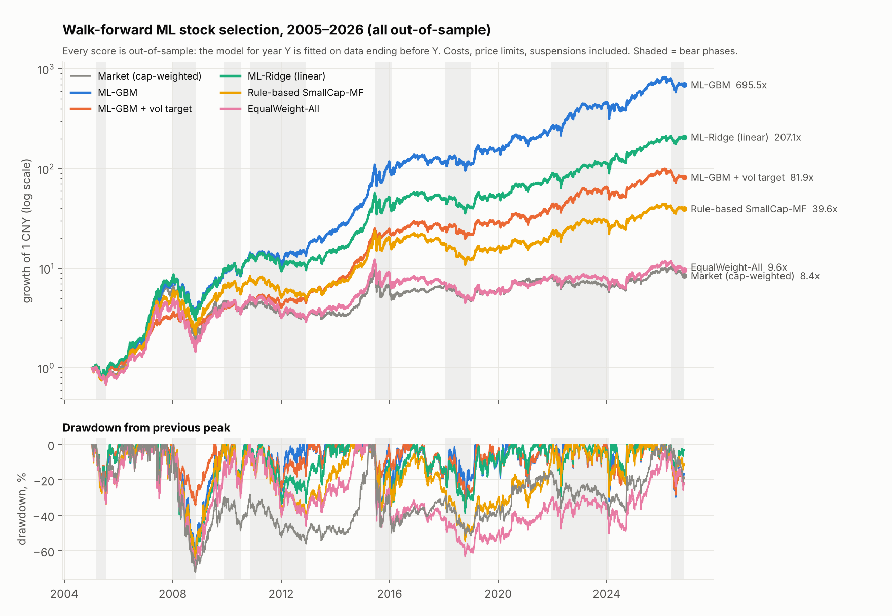
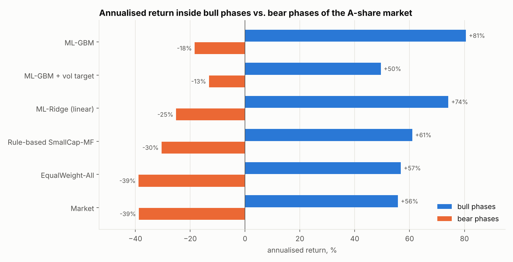

# Data-driven strategy: walk-forward machine-learning stock selection

A gradient-boosted model learns, from 45 technical indicators, which main-board stocks are likely to
beat the average stock over the next 20 trading days. It is refitted every year on past data only, and
every number below comes from years the model had not seen.

Full tables: [`results.md`](results.md). Reproduce with `python scripts/train_ml.py` (about 20 minutes).

## Result (out-of-sample, 2005-01-11 → 2026-11-10, after costs)

| Strategy | Return/yr | Max drawdown | Sharpe | Winning months | Months beating market | Holdings that made money |
|---|---:|---:|---:|---:|---:|---:|
| **ML model, top 50** | **35.0%** | −63.2% | 1.15 | 66% | 67% | 59% |
| **ML model + volatility target** | **22.4%** | **−34.4%** | 1.04 | 66% | 59% | – |
| Linear model (ridge), top 50 | 27.7% | −65.4% | 0.98 | 61% | 62% | 57% |
| Rule-based SmallCap-MF (earlier report) | 18.4% | −64.4% | 0.71 | 60% | 56% | 56% |
| Placebo: same model, shuffled labels | 4.0% | −77.1% | 0.21 | 52% | 50% | 50% |
| Equal weight, all stocks | 10.9% | −70.7% | 0.44 | 56% | 53% | – |
| Market (cap-weighted) | 10.3% | −72.3% | 0.44 | 58% | – | – |

- The model roughly doubles the return of the hand-written rules on the same stocks, period and costs.
- **Stock selection does not fix drawdown.** Fully invested, the model still lost 63% in 2008. The
  volatility target (cut exposure when market volatility exceeds 20%) brings that to −34% and costs about
  a third of the return.
- These are backtest figures for a strategy that trades 50 mid- and small-cap stocks at the opening
  auction. I would plan on materially less in live trading; see "How far to trust it".



## How the model is built

| Step | What is done | Why it cannot see the future |
|---|---|---|
| Universe | Shanghai/Shenzhen main board; listed ≥ 250 days, price ≥ 2 CNY, not ST-like, not in the least liquid 10%. About 1,660 stocks per day on average, delisted stocks included. | Every filter uses data up to that day. |
| Features | 45 indicators per stock per day: returns over 1–250 days, moving-average gaps, MACD (DIF, DEA, histogram), RSI, KDJ, Bollinger position, ATR and high–low range, close position within the day's range, distance from 250-day high/low, turnover rate and its changes, traded value, Amihud illiquidity, free-float cap, overnight vs. intraday return, and others. | Rolling and exponential windows only, on backward-adjusted prices. |
| Preprocessing | Each feature is converted to its percentile rank among that day's stocks. | Uses only the same day's cross-section; no statistics fitted over time. |
| Label | Rank of the return from the **open of day t+1** to the close of day t+20. | Starts after the signal day. |
| Training | LightGBM regression, refitted each January on all earlier data (expanding window). | Training rows must have their 20-day label window finished before the first test day (purge gap). |
| Hyper-parameters | Tree size chosen from three settings, number of trees by early stopping, on the last two years of each training window. | The validation slice is inside the training window and itself separated from the inner fit by 20 days. The test year is never used. |
| Portfolio | Every 20 trading days: 50 highest scores, equal weight, existing holdings kept while in the top 100. Orders at next open. | Same simulator as the earlier reports: costs, stamp duty, limit-up/limit-down, suspensions, delistings. |

Portfolio settings (50 names, 20 days, buffer) were fixed in advance from the first report, not tuned
on these results.

## Leakage checks

| Check | Result |
|---|---|
| Features recomputed on data **cut off at day t** vs. features from the full history, 6 random dates, all 45 features | Identical (maximum difference 0.0) |
| Universe membership on the cut-off data vs. full history | Identical |
| Placebo: labels shuffled within each day, same pipeline | IC 0.012, portfolio 4.0%/yr (below equal weight, as expected after costs) |
| Trade one day later than assumed | 33.1%/yr (from 35.0%) |
| Trade five days later | 26.5%/yr |
| Exact ST history instead of my ST heuristic (Shenzhen stocks, where the exchange publishes dated name changes) | 32.8%/yr vs. 32.6%/yr; under 1.2% of picks were ST in every year before 2026 |

A leak usually shows up as an edge that vanishes with a one-day delay or survives label shuffling.
Neither happens here: the edge decays gradually with delay and disappears with shuffled labels.

## Signal quality, year by year

Rank correlation (IC) between the model's score and the next 20-day return, on unseen years:

| | Mean IC | Worst year | Share of days with IC > 0 |
|---|---:|---:|---:|
| ML model | 0.142 | 0.102 (2017) | 89% |
| Linear model | 0.124 | 0.069 (2017) | 83% |
| Placebo | 0.012 | −0.034 | 59% |

The IC was positive in all 22 out-of-sample years. Average 20-day return relative to the average
stock rises steadily from the lowest-scored tenth (−2.35%) to the highest (+1.53%). More of the
signal is in **avoiding the worst stocks** than in finding the best, and a long-only investor can only
use the top half.

What the model relies on (share of split gain, averaged over the yearly models): recent turnover rate
(5-day 9%, 20-day 6%), traded value (7%), distance from the 250-day high (5%), gap to the 60-day
average (5%), 60-day volatility (3%), short-term returns (about 3% each). MACD and KDJ carry little
beyond what returns and moving-average gaps already contain. In plain terms it buys quiet, recently
weak, lightly traded stocks and avoids hot, heavily traded ones, which is the same effect the
rule-based strategy used, weighted more precisely.

## Across market cycles

| Period | ML model | ML + vol target | Rule-based | Market |
|---|---:|---:|---:|---:|
| 2005–2009 (bull, crash, rebound) | 58.0% | 33.0% | 47.0% | 36.4% |
| 2010–2014 (long sideways/bear, then bull) | 34.4% | 24.4% | 9.3% | 2.9% |
| 2015–2019 (crash, large-cap years, 2018 bear) | 29.3% | 18.6% | 8.7% | 2.0% |
| 2020–2026 | 24.2% | 16.1% | 13.7% | 4.6% |

| | Bull phases, annualised | Bear phases, annualised |
|---|---:|---:|
| ML model | +80.6% | −18.3% |
| ML + vol target | +49.5% | −13.2% |
| Rule-based SmallCap-MF | +61.0% | −30.5% |
| Market | +55.8% | −38.7% |



- The model beat the market in every one of the four sub-periods, but **its edge is shrinking**: from
  about 30 points a year over the market in 2010–2019 to about 20 in 2020–2026.
- It still loses in bear markets: −63% in 2008 and −27% in the 2005 decline. It lost money in four
  calendar years (2008 −45%, 2011 −14%, 2017 −14%, 2018 −3%) and is down 7% in 2026 so far.
- 2017 is the instructive year: the market rose 8% while the model lost 14%, because small and quiet
  stocks were out of favour all year.

## How far to trust it

| Change to the assumptions | Return/yr | Sharpe |
|---|---:|---:|
| Baseline (0.1% slippage per trade) | 35.0% | 1.15 |
| 0.3% / 0.5% slippage per trade | 29.9% / 24.9% | 1.01 / 0.87 |
| Only the 1,500 / 800 largest stocks | 30.3% / 24.6% | 1.07 / 0.91 |
| Exclude the least liquid 30% | 28.5% | 0.98 |
| 20 / 100 / 200 holdings | 34.3% / 32.9% / 29.6% | 1.11 / 1.10 / 1.02 |
| Rebalance every 10 / 40 days | 36.4% / 26.6% | 1.16 / 0.91 |
| Volatility target 15% / 25% (drawdown −33.5% / −41.5%) | 17.1% / 27.0% | 0.97 / 1.11 |

- **The result is not a micro-cap artefact.** The typical pick has a free float of 2–5 billion CNY
  and trades 30–70 million CNY a day, and restricting to the 800 largest stocks still gives 24.6%.
- **Costs are the main uncertainty.** Turnover is about 10× a year, and the backtest assumes fills at
  the open plus 0.1%. At 0.5% the return falls by ten points.
- **A number this high should be met with suspicion.** I found no leak, and strong predictability from
  turnover and reversal in A-shares is well documented, but a backtest cannot show how much of the
  edge survives real execution, a larger account, or more investors running similar models. The decline
  in the edge since 2020 is consistent with that pressure.
- **Not tested:** fundamentals, industry concentration of the portfolio, and position limits. The model
  may at times hold many stocks from one sector.
- **ST stocks.** The price-based ST filter caught 75–90% of ST stocks historically but only about half
  in 2026, apparently because ST stocks now move up to 10% a day. `scripts/ml_signal.py` therefore also
  drops any stock whose current name carries ST or 退.

## Using it

```bash
python scripts/download_data.py --update && python scripts/build_panel.py
python scripts/ml_signal.py --n 50 --capital 500000 --holdings <codes you hold>
```

This refits the model on everything whose outcome is known and prints the target list and the
exposure from the volatility target (81% as of 2026-11-10). Rebalance every 20 trading days; in
between, change only the overall exposure when it has moved by more than 10 points.
